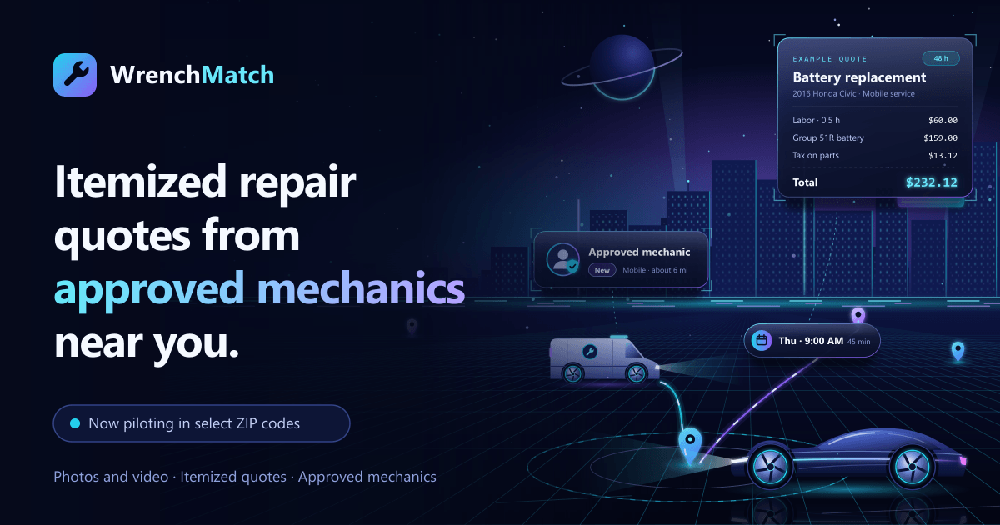
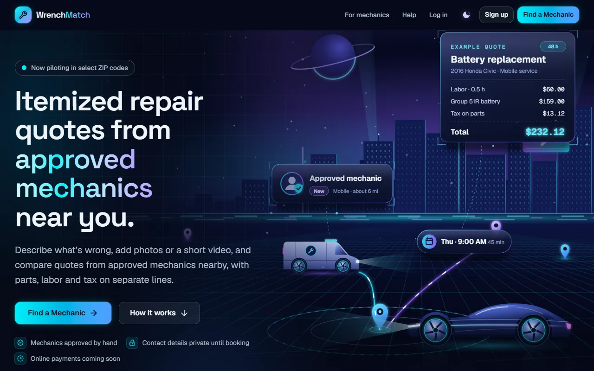
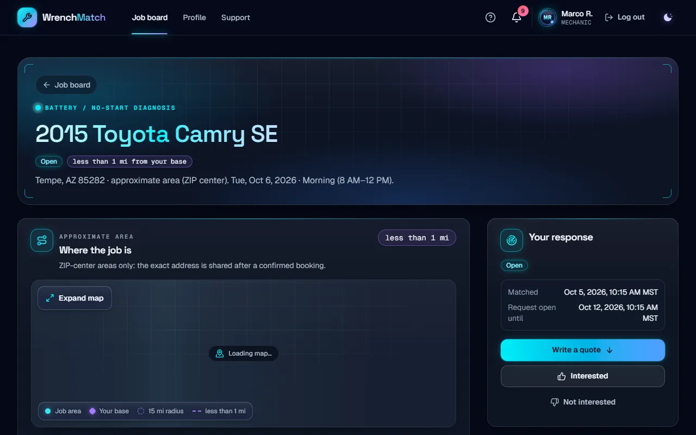
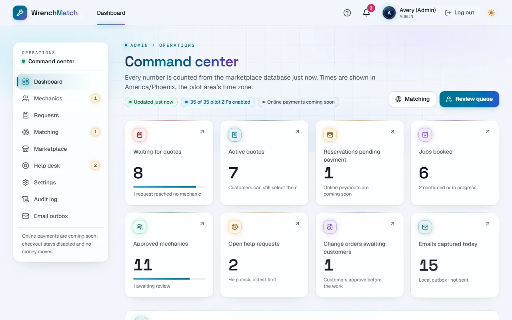
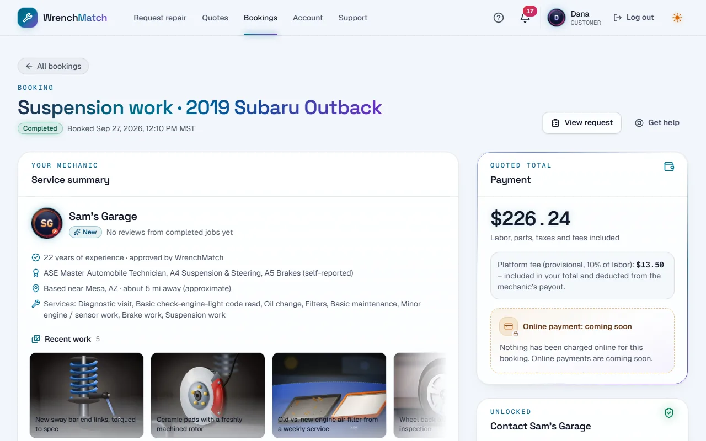
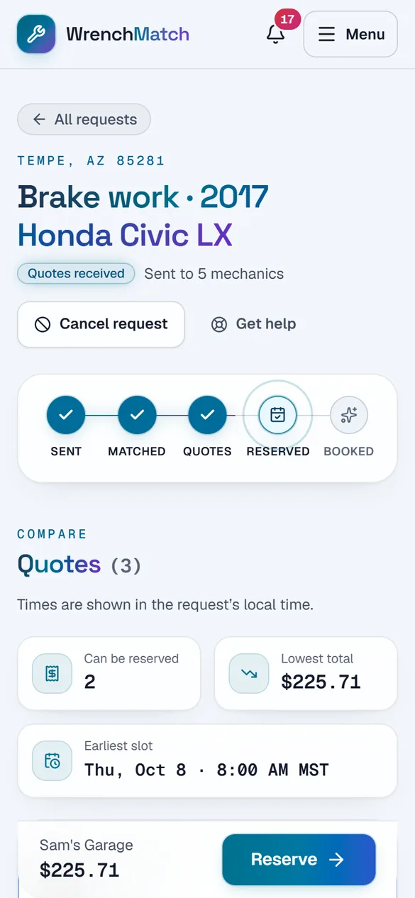
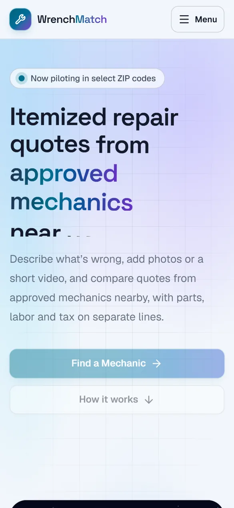
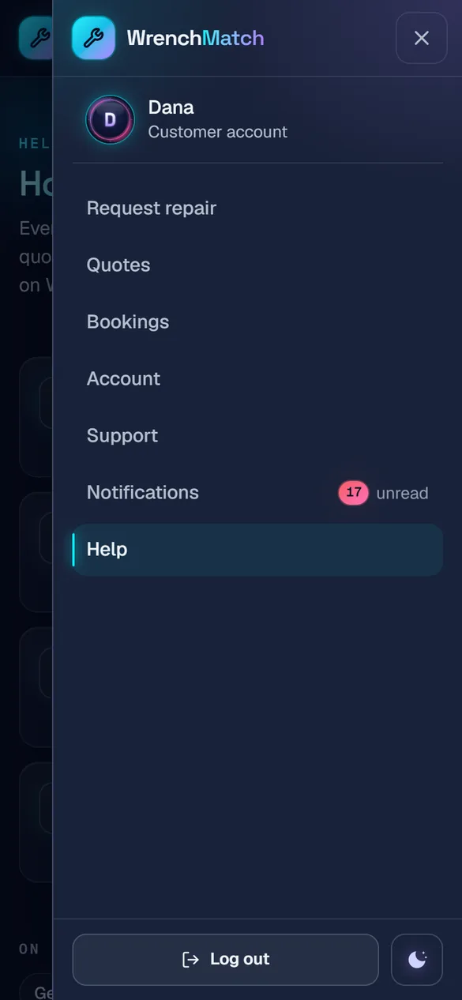
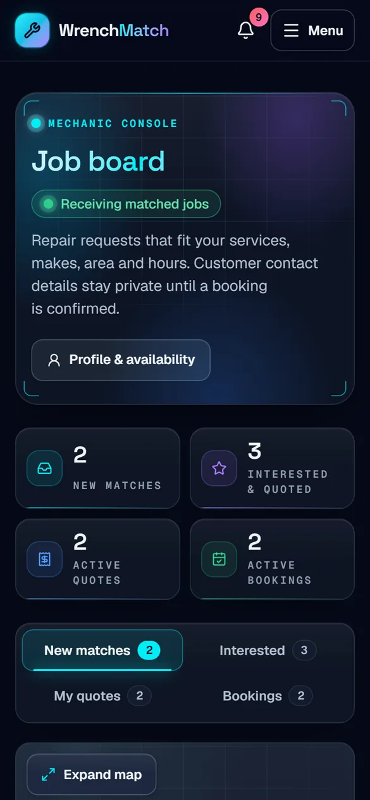

<p align="center">
  
</p>

<h1 align="center">WrenchMatch</h1>

<p align="center">
  <b>Itemized car repair quotes from approved mechanics near you.</b><br />
  Customers compare line-by-line quotes · mechanics quote and run their jobs · admins approve, match and support.
</p>

<p align="center">
  <a href="https://wrenchmatch.vercel.app"><b>Live pilot</b></a> ·
  <a href="#quick-start-this-windows-laptop">Run it locally</a> ·
  <a href="#screenshots">Screenshots</a> ·
  <a href="docs/DEPLOY.md">Deploy</a> ·
  <a href="docs/ARCHITECTURE.md">Architecture</a>
</p>

<p align="center">
  <a href="https://github.com/Hamza-Tahirr/wrenchmatch/actions/workflows/ci.yml"></a>
  
  
  
  
  
  
</p>

---

WrenchMatch is a car-repair marketplace prototype. A customer describes a problem (with photos
or a short video), approved mechanics nearby send itemized quotes, and the customer compares
them and reserves one. Mechanics apply, get approved by an admin, quote jobs and manage their
bookings. Admins run approvals, matching, settings and a help desk.

It is a **pilot-ready prototype** that runs on this laptop and, for sharing, on Vercel (see
[Deploy to Vercel](#deploy-to-vercel)). **Online payments are coming soon:**
reservations stay "pending payment", no card details are collected and nothing is charged or
paid out. Licensing, tax, insurance verification by a third party, real email delivery and a
production security review are **not** done (see [Remaining launch work](#remaining-launch-work)).

## Highlights

- Futuristic dark interface with motion throughout: page transitions, staggered reveals,
  parallax, animated counters, toasts. Everything respects the system "reduce motion" setting.
- Original vector illustrations, including a parallax landing page with a scroll-driven
  "How it works" story.
- Maps on the request, quote, job board and admin pages (MapLibre with free OpenFreeMap tiles,
  approximate ZIP-level locations only).
- Photo uploads: profile pictures, extra photos on a request, a mechanic work gallery, and
  before/after photos on bookings. Photo metadata (EXIF/GPS) is stripped on upload.
- One-click sample accounts on `/login` for every role (on this computer; the hosted site uses
  the normal login form).
- A light and a dark theme (toggle next to Log out, remembered per browser) and full phone
  support: slide-in menu, sticky actions, phone-friendly tables and maps, mobile parallax.

## Screenshots



| Mechanic job detail with the approximate-area map | Admin command center (light theme) |
| :---: | :---: |
|  |  |
| **Customer booking with the mechanic's work photos** | **Phone: comparing quotes with a sticky Reserve bar** |
|  |  |

| Phone: landing (light) | Phone: menu with the theme toggle | Phone: mechanic job board (dark) |
| :---: | :---: | :---: |
|  |  |  |

## Quick start (this Windows laptop)

The project uses **Node.js 24 LTS**. This machine's system Node is 26, so a portable Node 24 sits
in `.tools/` (git-ignored). Put it first on `PATH` in every new terminal:

```powershell
# PowerShell
$env:PATH = "D:\Vs code projects\Demo\.tools\node-v24.21.0-win-x64;" + $env:PATH
```
```bash
# Git Bash
export PATH="/d/Vs code projects/Demo/.tools/node-v24.21.0-win-x64:$PATH"
```

On another machine, any Node 24 install works (`.nvmrc` says `24.21.0`).

```bash
npm ci                 # install the exact locked dependencies
npm run db:reset       # create .data/app.db and fill it with sample data and pictures
npm run build          # production build (fastest to use)
npm start              # http://localhost:3000
# or, while developing:
npm run dev            # http://localhost:3000 (pages compile on first visit)
```

Open **http://localhost:3000**. `npm run db:reset` can be re-run at any time to get fresh sample
data (dates in the sample data are relative to when you seed). It works even while the server
is running.

`.env.local` (git-ignored) sets `DEMO_MODE=true`, which shows the one-click sample-account
buttons on `/login`. They only appear and work on this computer (localhost), and production
builds hide them unless `DEMO_MODE=true` is set. Never set it on a public deployment, and keep
`.env.local` to that one line: hosted credentials there would point the local app at the hosted
database. `.env.example` lists all variables.

## Sample accounts

Every sample account uses the password **`repair-pilot-2026`**. On this computer the easiest way
in is the **"Log in as …"** buttons on `/login`; on the hosted site, type the email and password.

| Account | Role | What it shows |
| --- | --- | --- |
| `customer@example.com` (Dana) | Customer | Requests with quotes to compare, a reservation pending payment, a confirmed job with a change order to approve, completed jobs with invoices |
| `customer2@example.com` (Luis) | Customer | A second customer, to show that Dana's records stay private; includes a request that matched nobody |
| `mechanic@example.com` (Marco R.) | Mechanic | Approved, mobile + garage: job board, quoting, bookings, work gallery |
| `mechanic2@example.com` (Priya S.) | Mechanic | Approved, mobile only |
| `garage@example.com` (Sam's Garage) | Mechanic | Approved, garage only, approved for brake and suspension work |
| `jordan@example.com` (Jordan T.) | Mechanic | Offers brake work but is not approved for it (safety gating) |
| `applicant@example.com` (Alex K.) | Mechanic | Application waiting for admin review, with documents |
| `suspended@example.com` (Taylor M.) | Mechanic | Suspended, so left out of matching |
| `expired@example.com` (Morgan L.) | Mechanic | Approved but insurance expired, so left out of matching |
| `rejected@example.com` (Casey D.) | Mechanic | Application rejected |
| `admin@example.com` (Avery) | Admin | Approvals, matching diagnostics, marketplace, settings, help desk, audit log, email outbox |

More customers and mechanics (same password) make the maps and lists feel real; see
[docs/DEMO_DATA.md](docs/DEMO_DATA.md) for every account and scenario.

## Deploy to Vercel

**Live: <https://wrenchmatch.vercel.app>** (sign in with a sample email and the password below).

The app also runs on **Vercel** (Hobby plan) with a permanent public link. Vercel functions keep
no files, so the hosted site stores its data in **Turso** (hosted libSQL, SQLite-compatible) and
its uploads in a private **Vercel Blob** store. The app switches to them only when
`TURSO_DATABASE_URL` and `BLOB_READ_WRITE_TOKEN` are set; otherwise it keeps using `.data/` as
above. Full guide: [docs/DEPLOY.md](docs/DEPLOY.md).

Set up today: the Vercel project `hamza-tahirrs-projects/wrenchmatch` (functions in Mumbai,
`bom1`), the Turso database `wrenchmatch-db` (AWS Mumbai, added through the Vercel Marketplace)
and the private Blob store `wrenchmatch-uploads`. Their credentials are Vercel project variables;
`.env.vercel` (git-ignored) keeps a local copy for the push scripts.

```bash
vercel env pull .env.vercel --environment=production --yes   # credentials for the push scripts
npm run db:reset              # fresh sample data on this laptop
npm run db:push:remote        # copy the local database to Turso (replaces what is there)
npm run uploads:push:remote   # copy the sample pictures and documents to the Blob store
vercel deploy --prod          # build on Vercel and publish
```

- **The link to share** is the production domain (the `*.vercel.app` name under **Domains** on
  the project page).
- **Signing in:** type a sample email and the password `repair-pilot-2026`. The one-click buttons
  appear only on `localhost`. Anyone with the link and the password can use every sample account,
  the admin included.
- **Refreshing the sample data:** run the three `npm run` commands again (no redeploy needed).
  This replaces everything created on the hosted site since the last refresh.
- **Limits:** one form can send at most 4 MB of files (Vercel refuses requests over 4.5 MB).
  Photos are shrunk in the browser automatically; a video or PDF must be under 4 MB. Requests
  stop after 60 seconds.
- **Hobby plan:** personal, non-commercial use only. Move the project to Pro before a commercial
  pilot.
- **Vercel CLI on this laptop:** `vercel link` and the commands that connect storage can write the
  project's variables into `.env.local` and add lines to `.gitignore`. Check both afterwards;
  `vercel env pull` always needs the `.env.vercel` file name.

## What's inside: the eight areas

| Area | Routes |
| --- | --- |
| 1. Landing | `/` (primary action: **Find a Mechanic**) |
| 2. Request repair | `/request` (ZIP coverage map, vehicle, problem with photos/video, time, mobile or garage, contact, consents) |
| 3. Quotes | `/quotes`, `/requests/[id]` (actual number of mechanics notified, quote comparison, map) |
| 4. Booking / payment preview | `/bookings`, `/bookings/[id]` (itemized breakdown, platform fee, consent record, "online payments coming soon") |
| 5. Customer account | `/account` (requests, quotes, reservations, bookings, invoices, change orders, reviews, profile photo) |
| 6. Mechanic signup / profile | `/signup?role=mechanic`, `/mechanic/apply`, `/mechanic/profile`, `/mechanic/gallery` |
| 7. Mechanic job board | `/mechanic/jobs`, `/mechanic/jobs/[requestId]`, `/mechanic/bookings/[id]` |
| 8. Admin dashboard | `/admin` and `/admin/{mechanics,requests,matching,marketplace,support,settings,audit,mailbox}` |

Also: `/login`, `/signup`, `/help` (Help Center), `/notifications`, `/support` (help requests).

### Features by role

- **Customers:**
  - submit requests in the pilot ZIP codes and see how many mechanics were actually notified (or an honest "no one available" state);
  - compare itemized quotes (labor, parts included or not, taxes/fees, scope, earliest slot, duration, expiry, mechanic profile and gallery, rating or "New");
  - reserve one (an immutable quote snapshot and a pending-payment reservation);
  - cancel requests or reservations;
  - approve or reject change orders, see invoices, review completed jobs, add photos, ask for help.
- **Mechanics:**
  - apply with documents, insurance, services, makes, service area and weekly availability;
  - after admin approval, get matched to nearby jobs, mark interest and submit itemized quotes (a quote holds its time slot until it expires), or withdraw them;
  - on confirmed bookings, start and complete the job, propose change orders, issue the invoice, see payout status and add before/after photos.
- **Admins:**
  - review applications and documents, and approve, reject, suspend or reinstate mechanics with reasons;
  - approve safety-critical work (brakes, suspension);
  - configure service categories and pilot ZIP codes;
  - inspect matching failures on a map and re-run matching;
  - see requests, quotes, reservations and bookings, and resolve help requests;
  - read the audit log and the local email outbox.

## How it works under the hood

### Stack (pinned versions)

Next.js 16.3.8 (App Router, Turbopack), React 19.3, TypeScript 6.0.3 (strict), Tailwind CSS 4.3.3,
Node.js 24 LTS, SQLite via better-sqlite3 13.0.3 + Kysely 0.29.6 (on Vercel: Turso through
@libsql/client 0.18.0, uploads in Vercel Blob through @vercel/blob 2.8.0), Zod 4.6.5, sharp 0.35.5,
MapLibre GL 6.11.2, Motion 14.0.0, lucide-react, Vitest 5.0.3, Playwright 1.63.0 (installed
Google Chrome). ESLint 9.39.5 is used because `eslint-config-next` 16.3.8's React plugin does not
support ESLint 10 yet.

### Why SQLite instead of local Supabase

The original plan was local Supabase (Postgres/PostGIS, Auth, Storage, RLS) in Docker. Docker
Desktop's installation on this laptop is broken, so the owner chose SQLite for now. Each
Supabase piece has a local replacement behind a small module boundary:

| Concern | Here | Later |
| --- | --- | --- |
| Database + migrations | SQLite, SQL migrations in `db/migrations` | Port the migrations to Postgres; Kysely has a Postgres dialect |
| Radius search | Haversine distance over ZIP centroids (`src/server/matching`) | PostGIS |
| Auth | App sessions: scrypt password hashes, random session tokens (hashed in the DB), httpOnly cookie | Supabase Auth |
| Authorization | Every server query is scoped to the signed-in user; the database enforces invariants with constraints and triggers | Add RLS as a second check |
| Private files | `.data/uploads` (outside `public/`), served only by `/api/files/[id]` after a permission check | Supabase Storage private buckets |
| Email | Captured in the database and shown in the admin "Email outbox" (nothing is sent) | A real email provider |

Details: [docs/ARCHITECTURE.md](docs/ARCHITECTURE.md).

### Privacy and security

- Before a booking is confirmed, mechanics see only the job, an approximate area (ZIP level) and
  sanitized photos. They never see the customer's phone, email, exact address or video.
  Customers see a mechanic's display name, experience, services, approximate area, gallery and
  rating ("New" until there are genuine reviews), never their contact details or garage address.
- Anything you are not allowed to see answers "not found", so record IDs can't be probed.
- Money is integer cents, computed only on the server from saved quote lines. The database
  re-checks totals and the platform fee, blocks a second reservation on the same request, and
  blocks any move past "pending payment" while payments are not connected.
- Mechanics can't extend their own insurance: after admin review, the insurance on file changes
  only when an admin verifies an uploaded certificate.
- Uploads are checked by content (not by file name), size-limited, re-encoded, and stripped of
  metadata. ID and insurance documents are visible only to their owner and admins.

### Payments (not live yet)

The checkout, reservation confirmation, change-order payments, mechanic payout setup, refunds,
payouts and payment webhooks are all switched off and say so in the UI. The integration point
and the plan for Stripe Connect are in [docs/PAYMENTS.md](docs/PAYMENTS.md).

### Maps

Maps use MapLibre GL with OpenFreeMap's free tiles (no API key; internet needed for the map
tiles). Only approximate points are plotted: ZIP-code centroids for requests and mechanic bases.

## Commands

| Command | What it does |
| --- | --- |
| `npm run dev` | Development server on port 3000 |
| `npm run build` / `npm start` | Production build / server |
| `npm run db:reset` | Recreate the database and uploads with fresh sample data |
| `npm run db:migrate` | Apply new migrations |
| `npm run db:types` | Regenerate `src/server/db/schema.generated.ts` from the migrations |
| `npm run db:push:remote` | Copy the local database to the hosted Turso database (replaces it; see [docs/DEPLOY.md](docs/DEPLOY.md)) |
| `npm run db:migrate:remote` | Apply new migrations to the hosted database, keeping its data |
| `npm run uploads:push:remote` | Copy the local uploads to the hosted Blob store |
| `NEXT_DIST_DIR=.next-check npx next build` | Trial production build in its own folder, leaving `.next` (used by `npm start`) alone |
| `npm run typecheck` / `npm run lint` | TypeScript and ESLint |
| `npm test` | Unit and integration tests (Vitest, temporary databases) |
| `npm run test:e2e` | End-to-end tests in the installed Google Chrome (resets the sample data first) |
| `npm run verify` | Typecheck, lint, tests and build in one go |

## Latest verification

Run on 5 October 2026 (evening), after the theme, mobile and Vercel work:

- `npx tsc --noEmit`: 0 errors. `npm run lint`: clean.
- `npm test`: 936 of 936 tests passed (unit + integration, local SQLite driver, credential guard).
- `npm run test:libsql`: 641 of 641 integration tests passed on the libSQL (Turso) driver.
- `npm run build`: production build succeeds (39 routes, all dynamic, no database needed at build).
- Local production server: 44 page loads across signed out, customer, mechanic and admin, at 390 and
  1280 px in both themes: no console errors, no sideways scrolling, theme toggle and mobile menu work.
- **Hosted site** (<https://wrenchmatch.vercel.app>): 36 page loads across all roles at 1280 px (dark) and
  390 px (light) with typed sample logins, every page HTTP 200 in 0.3-0.8 s warm (the first visit
  after a quiet spell takes a few seconds while a function starts); photos load from the private
  Blob store; the job board map loads. A 6000x4000, 19 MB photo upload was shrunk in the browser,
  accepted under Vercel's 4.5 MB request limit, stored in Blob and served back.
- `npm run test:e2e` (installed Google Chrome, desktop + phone projects): 51 passed, 4 conditional
  skips, 0 failed (46 minutes).
- A crawl of every main page including detail pages (40 pages for signed out, Dana, Marco R.,
  Alex K. and Avery): 160 page loads locally (390 and 1280 px, light and dark) and 80 on the hosted
  site (1280 px dark, 390 px light): no console errors, no failed files, no sideways scrolling, no
  "demo" text; the mobile menu and the theme toggle work on every role.

Earlier run on 5 October 2026:

- `npm run test:e2e` (installed Google Chrome): 49 passed on the first full run; the 2 that failed
  were fixed (a "demo" word in the sample password, and a test locator) and pass on re-run;
  4 tests are conditional skips.
- A separate check of every main page for each role, at desktop and phone widths (68 page loads),
  found no console errors, no broken pages, no "demo" text and no sideways scrolling. Maps load
  their tiles.

Speed on the production server (`npm start`, warm, median of 3 requests): `/` 0.18 s, `/login`
0.05 s, `/help` 0.05 s, `/request` 0.03 s, `/signup` 0.04 s. Full page loads in Chrome, including
images and maps, take 0.1-1.5 s.

## Troubleshooting

- **"Database is locked" or reset problems:** `npm run db:reset` works while the server runs (it
  empties the open file in place).
- **Port 3000 in use:** stop the other server, or run `npm run dev -- -p 3001`.
- **The app stopped responding after the PC slept or restarted:** start it again (`npm start` or
  `npm run dev`).
- **Native module errors after switching Node versions:** use Node 24 (see Quick start).
- **Maps show "Map unavailable":** the map tiles need internet access.
- **Problems on the hosted site** (empty database, uploads refused, a Vercel login prompt): see
  the troubleshooting table in [docs/DEPLOY.md](docs/DEPLOY.md).

## Project structure

```
db/migrations/         SQL migrations (source of truth)
db/seed-data/          Pilot ZIP centroids (US Census 2020 Gazetteer)
docs/                  ARCHITECTURE, DEMO_DATA (sample data), DEPLOY (Vercel), PAYMENTS, MEDIA, UI, VISUALS
scripts/               db-reset, db-migrate, gen-db-types, seed (sample data + generated pictures)
src/app/               Routes: (public), (customer), (mechanic), (admin), api/files, notifications, support
src/components/        UI kit, layout, motion, maps, illustrations, parallax, media
src/lib/               Shared client-safe code (domain constants, time, formatting, validation)
src/server/            Server-only code: db, auth, storage, matching, pricing, customer, mechanic, admin, media, payments
tests/                 unit, integration (Vitest) and e2e (Playwright)
vercel.json            Vercel settings (region, function time limit); .vercelignore lists what is not uploaded
```

## Contributing

1. Branch from `main`, make the change, and keep `npm run typecheck`, `npm run lint` and
   `npm test` green (`npm run test:libsql` too when database code changes).
   `npm install` also switches on the credential guard: commits and pushes that contain a
   secret are refused (see [SECURITY.md](SECURITY.md)).
2. Open a pull request. The template lists the project rules (privacy, money, payments,
   migrations), and CI runs typecheck, lint, both test suites and a production build.
3. See [CONTRIBUTING.md](CONTRIBUTING.md) for the project rules. After merging, publish with
   `vercel deploy --prod`; refresh the hosted sample data with the
   commands in [Deploy to Vercel](#deploy-to-vercel). Report security problems as described in
   [SECURITY.md](SECURITY.md).

## Remaining launch work

- **Payments:** Stripe Connect onboarding, hosted Checkout with platform-computed amounts,
  signature-verified webhooks, refunds and payouts ([docs/PAYMENTS.md](docs/PAYMENTS.md)).
- **Hosting:** the Vercel deployment (Turso + Vercel Blob) is a non-commercial showcase on the
  Hobby plan. A real pilot needs a paid plan, backups and monitoring, and later hosted Postgres
  with PostGIS and row-level security.
- **Accounts:** real email delivery and email verification, admin MFA, account deletion and data
  retention, and IP rate limiting that trusts only your own proxy.
- **Uploads:** moderation of user photos; video metadata removal (needs ffmpeg).
- **Business and legal (MVP_PLAN section 11):** pilot area, repair/referral licensing, insurance
  verification, mechanic terms, tax treatment, cancellation and refund policy, privacy policy.
- **Quality:** a formal accessibility audit and a load test.
